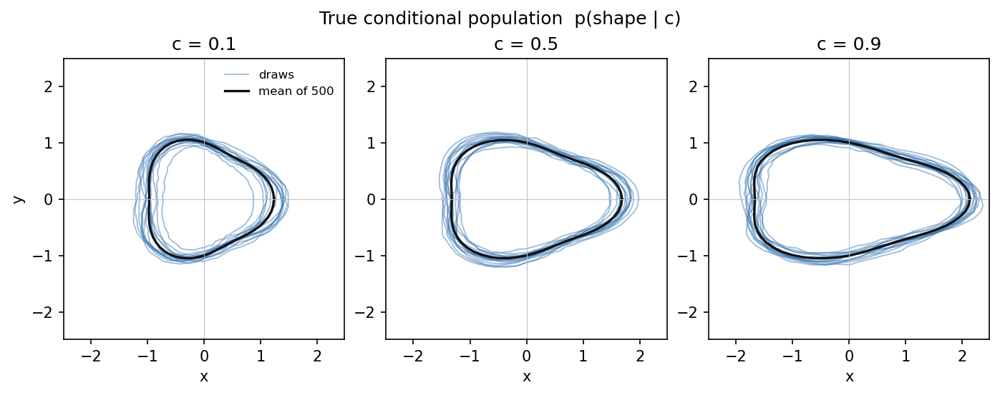
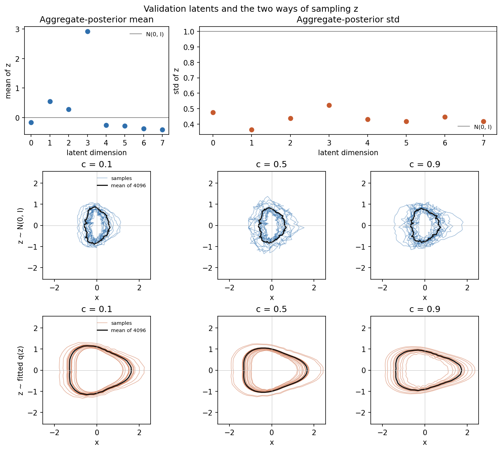
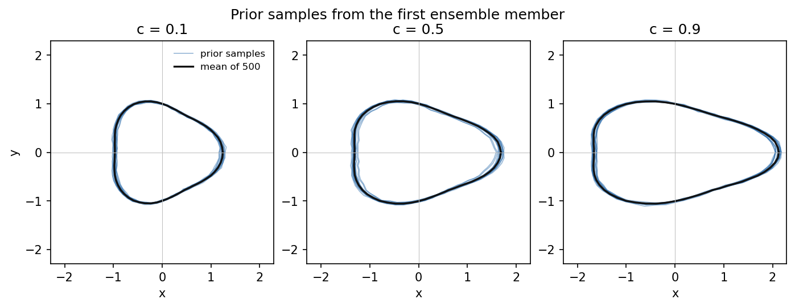
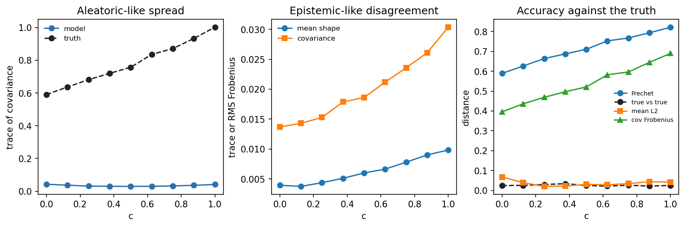
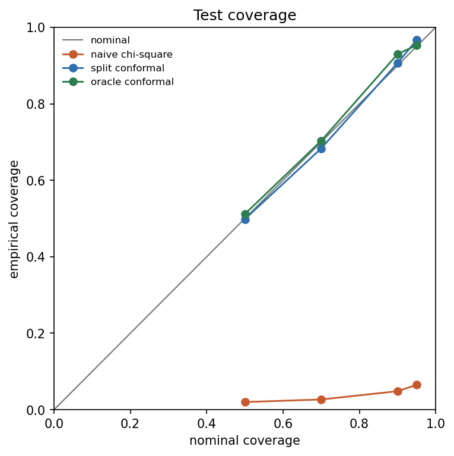
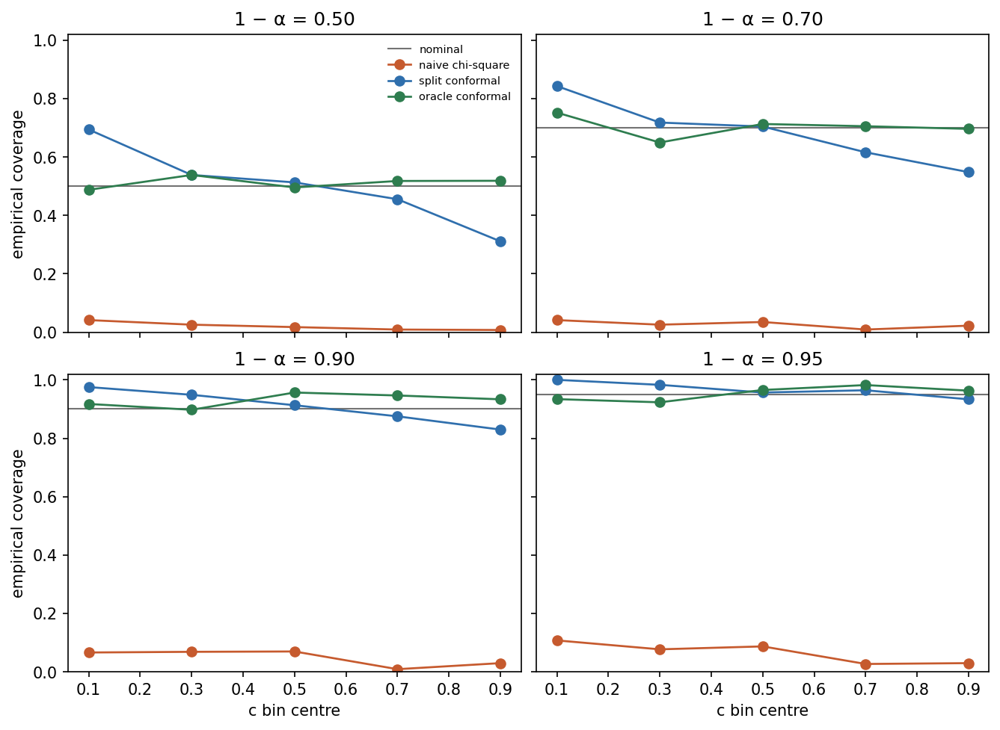

# Conformal geometry generators

Uncertainty here is a property of the learned population p(shape | c), not a property of one reconstructed mesh. The data are synthetic closed contours in the plane whose conditional law is known, so a generated population can be compared with the truth, and a prediction set can be checked against that same truth.

## Repository

```
configs/default.yaml          data, model, training, ensemble, both sweeps
src/cgg/data.py               the contour generator and the 70/15/15 split
src/cgg/model.py              conditional VAE
src/cgg/train.py              one seed, KL warm-up, validation cut of train
src/cgg/ensemble.py           five seeds, population scores, both sweeps
src/cgg/uncertainty.py        Gaussian fits and the 2-Wasserstein distance
src/cgg/diagnostics.py        aggregate posterior of the beta=0.003 model
src/cgg/conformal.py          Mahalanobis scores, chi-square, split conformal
src/cgg/plots.py              figures
tests/                        data, model, distances, conformal quantile
results/                      json records and figures
results/baseline_collapsed/   beta=0.5, no KL warm-up
```

Calibration and test rows are not used to train, to choose β, or to choose the covariance floor. Checkpoints are gitignored.

## Quickstart

From the repository root, with the packages in `requirements.txt`:

```
$env:PYTHONPATH = "src"
python -m cgg.data --config configs/default.yaml --out results
python -m cgg.ensemble --config configs/default.yaml --out results --checkpoints checkpoints
python -m cgg.conformal --config configs/default.yaml --out results --checkpoints checkpoints
python -m pytest
```

`pytest.ini` puts `src` on the path for the tests. The three scripts need `PYTHONPATH`. On Windows, set `KMP_DUPLICATE_LIB_OK=TRUE` before the ensemble or conformal run: PyTorch and MKL each ship an OpenMP runtime, and the process aborts when both load.

## Methods

A shape is 64 points, stored as 128 coordinates, x then y. The unobserved factors are radius `R`, triangular amplitude `a`, phase `phi`, and elongation `e`. The condition `c` is observed. Elongation has conditional mean `1 + c`. A latent width of 4 matches those four factors. `c` is not one of them.

The model is a conditional VAE. The loss is the summed squared error over the 128 coordinates plus β times the diagonal-Gaussian KL. β ramps linearly from 0 over the first 20 epochs. The checkpoint is the lowest validation loss after the ramp, on a holdout cut from the train split only.

The ensemble is five seeds. A conditional population is the pool of 4096 prior draws from each member. Spread, disagreement, and accuracy use Gaussian summaries: covariance trace, disagreement of the five mean shapes, and the 2-Wasserstein distance between Gaussian fits. A ridge of `1e-4` is added inside that distance only.

Two sweeps, each one seed per setting, selected without calibration or test rows:

- `results/beta_sweep.json` minimises the absolute trace error at c = 0.5. It chose β = 0.003.
- `results/beta_sweep_v2.json` minimises the mean 2-Wasserstein distance at c in {0.1, 0.5, 0.9}, over β in {0.5, 0.3, 0.1, 0.03, 0.01, 0.003, 0.001} and latent width in {4, 8}. It chose β = 0.3 and width 4. That is the ensemble below.

The nonconformity score is the squared Mahalanobis distance of a real shape from the Gaussian of the population at its own c. Under a correct 128-dimensional Gaussian that score is chi-square with 128 degrees of freedom, which is the naive threshold. Every covariance, model and oracle, is replaced by `cov + noise_std² I` before the solve. `noise_std` is 0.01, the coordinate noise in the generator, so the floor is `1e-4`. Coverage was not used to pick it. On the calibration conditions the ensemble's raw trace has median 0.037 and its smallest eigenvalue has median `5.0e-6`; after the floor the median trace is 0.050 and the median condition number is 229 (`results/conformal.json`). The floor does not lift the trace toward the oracle median of 0.774. The same rule on the oracle moves the median trace from 0.774 to 0.787.

The naive rule uses `chi2.ppf(1 - α, df=128)` on the ensemble scores. Split conformal uses the order statistic `k = ceil((n+1)(1-α))` of the 600 calibration scores, and covers a test shape when its score is at most that value. The oracle uses the same conformal rule with the mean and covariance of 4096 fresh draws from the true conditional at that c.

## Results

The split is 2800 / 600 / 600. Mean elongation of fresh draws, `rms(x) / rms(y)`, is 1.098, 1.502, and 1.898 at c = 0.1, 0.5, and 0.9 (`results/data_summary.json`).



### Trace sweep

One seed, latent width 8, true trace 0.756 at c = 0.5. Values below are rounded from `results/beta_sweep.json`.

| β | Best val KL | Generated trace | 2-Wasserstein |
|---:|---:|---:|---:|
| 0.1 | 3.176 | 11.186 | 4.219 |
| 0.03 | 5.041 | 6.779 | 5.775 |
| 0.01 | 7.969 | 3.228 | 5.845 |
| 0.003 | 12.321 | 2.373 | 5.389 |

β = 0.003 is the closest trace and is still about three times the truth. Its 2-Wasserstein distance is worse than the collapsed baseline.

### Wasserstein sweep

True trace at c = 0.5 is 0.779. Mean W2 is the average of c = 0.1, 0.5, and 0.9. Rounded from `results/beta_sweep_v2.json`.

| β | Width | Best val KL | Mean W2 | c = 0.5 elongation | c = 0.5 trace |
|---:|---:|---:|---:|---:|---:|
| 0.5 | 4 | 0.002 | 0.792 | 1.504 | 0.014 |
| 0.5 | 8 | 0.002 | 0.756 | 1.500 | 0.031 |
| **0.3** | **4** | **0.077** | **0.666** | **1.492** | **0.069** |
| 0.3 | 8 | 0.019 | 0.743 | 1.524 | 0.031 |
| 0.1 | 4 | 2.982 | 3.456 | 1.176 | 8.883 |
| 0.1 | 8 | 3.176 | 4.256 | 1.028 | 11.437 |
| 0.03 | 4 | 4.705 | 4.222 | 1.052 | 5.831 |
| 0.03 | 8 | 5.041 | 5.749 | 0.787 | 7.009 |
| 0.01 | 4 | 8.898 | 3.957 | 1.241 | 4.474 |
| 0.01 | 8 | 7.969 | 5.807 | 0.732 | 3.359 |
| 0.003 | 4 | 12.424 | 3.923 | 1.235 | 3.803 |
| 0.003 | 8 | 12.321 | 5.345 | 0.760 | 2.452 |
| 0.001 | 4 | 18.276 | 4.226 | 1.164 | 3.431 |
| 0.001 | 8 | 18.561 | 5.531 | 0.711 | 2.079 |

### Diagnostics of the trace-selected model

β = 0.003, width 8, seed 0, validation shapes only (`results/diagnostics.json`). The aggregate posterior is not N(0, I): the largest absolute mean is 2.916, and the eight standard deviations lie between 0.364 and 0.521.

| Source | c | Elongation | True elongation | Trace | True trace | W2 |
|---|---:|---:|---:|---:|---:|---:|
| prior | 0.1 | 0.664 | 1.100 | 2.353 | 0.637 | 3.389 |
| prior | 0.5 | 0.760 | 1.498 | 2.452 | 0.786 | 5.333 |
| prior | 0.9 | 0.859 | 1.899 | 2.363 | 0.956 | 7.285 |
| fitted q(z) | 0.1 | 1.317 | 1.100 | 2.906 | 0.637 | 2.377 |
| fitted q(z) | 0.5 | 1.484 | 1.498 | 2.896 | 0.786 | 1.051 |
| fitted q(z) | 0.9 | 1.696 | 1.899 | 2.812 | 0.956 | 2.300 |



Sampling z from the fitted aggregate posterior, instead of from N(0, I), produces smooth triangles and a much smaller Wasserstein distance. The trace stays near 2.9 against a true trace near 0.6–1.0.

### Selected ensemble

β = 0.3, latent width 4. Best validation KL on the five seeds is 0.077, 0.010, 0.003, 0.002, and 0.021 (`results/training.json`). Prior elongation at c = 0.1, 0.5, and 0.9 is 1.106, 1.493, and 1.890 (`results/generated_samples.json`). At c = 0.5 the mean within-model trace is 0.029 against a true trace of 0.757, the 2-Wasserstein distance is 0.711, and the mean L2 is 0.031 (`results/uncertainty.json`). Endpoint disagreement of the mean shape is 0.0069 against 0.0060 at c = 0.5. The collapsed baseline in `results/baseline_collapsed/` has trace 0.026 and 2-Wasserstein distance 0.739 at the same condition, against the same true trace 0.757.





### Conformal coverage on the test split

600 calibration scores set the conformal thresholds. 600 test shapes are scored. Nominal coverage is `1 - α`.

| Nominal | Naive coverage | Naive threshold | Split conformal | Conformal threshold | Oracle conformal | Oracle threshold |
|---:|---:|---:|---:|---:|---:|---:|
| 0.50 | 0.020 | 127.3 | 0.498 | 540.1 | 0.512 | 66.3 |
| 0.70 | 0.027 | 135.9 | 0.683 | 784.2 | 0.703 | 70.6 |
| 0.90 | 0.048 | 148.9 | 0.907 | 1362.5 | 0.930 | 78.5 |
| 0.95 | 0.065 | 155.4 | 0.967 | 1825.1 | 0.953 | 80.9 |

The median ensemble score is 542 on the test split. The chi-square thresholds sit near 127–155, so almost every real shape falls outside the naive set. All four naive coverages are outside nominal ± 3 percentage points. The ensemble covariance is the reason: its calibration trace median is 0.037, against an oracle trace median of 0.774, and the noise floor only moves the ensemble trace to 0.050.

Split conformal raises the threshold to the calibration order statistic. Its four marginal coverages, 0.498, 0.683, 0.907, and 0.967, are inside nominal ± 3 percentage points.

The oracle at nominal 0.90 covers 558 of 600 test shapes, coverage 0.930, a gap of 0.030. That is the boundary of the ±3 percentage point band, not past it. The other three oracle levels are inside the band. The median oracle score is 65.9, well below the mean of a chi-square random variable with 128 degrees of freedom, which is 128. The true conditional is a 4-factor contour plus small noise, and the Gaussian with its covariance is a blunt summary of that law. Conformal still uses exchangeable scores, so the marginal guarantee does not need the Gaussian to be right.



Conditional coverage uses five equal-width bins of c. Counts are 121, 117, 115, 112, and 135. Split conformal coverage:

| c bin | Nominal 0.50 | 0.70 | 0.90 | 0.95 |
|---|---:|---:|---:|---:|
| [0.0, 0.2) | 0.694 | 0.843 | 0.975 | 1.000 |
| [0.2, 0.4) | 0.538 | 0.718 | 0.949 | 0.983 |
| [0.4, 0.6) | 0.513 | 0.704 | 0.913 | 0.957 |
| [0.6, 0.8) | 0.455 | 0.616 | 0.875 | 0.964 |
| [0.8, 1.0) | 0.311 | 0.548 | 0.830 | 0.933 |

Coverage falls as c increases. At nominal 0.50 the outer bins are 0.694 and 0.311. At nominal 0.90 they are 0.975 and 0.830. Most of these bins are outside nominal ± 3 percentage points. The true trace in `results/uncertainty.json` rises from 0.591 at c = 0 to 1.002 at c = 1, while the ensemble trace stays near 0.03–0.04. One threshold fit on the mixture of all c overcovers the tight condition and undercovers the wide one. The finite-sample guarantee is marginal over the calibration and test draws, not conditional on c.

Every naive bin is below 0.11, so all of them are outside the band. The oracle's bin coverage stays near the nominal line. Seven of its twenty bin comparisons still leave the ±3 percentage point band; the largest is 0.957 against nominal 0.90 in c ∈ [0.4, 0.6). Those gaps are a few points on about 120 shapes, not the monotone swing of the ensemble scores.



## Findings and limitations

Posterior collapse at β ≥ 0.3. In the Wasserstein sweep those four settings have validation KL from 0.002 to 0.077 and a prior trace at c = 0.5 from 0.014 to 0.069, against a true trace of 0.779. The retrained ensemble matches that regime: validation KL at most 0.077, and trace 0.029 against 0.757 at c = 0.5. The mean contour elongates with c. The samples sit on that contour.

Prior hole at β ≤ 0.1. Validation KL jumps to between 3 and 19, and the prior trace at c = 0.5 is between 2.1 and 11.4. Mean elongation moves away from `1 + c`, especially at width 8. The diagnostics at β = 0.003 show why. The aggregate posterior on validation shapes has a coordinate mean of 2.92 and standard deviations near 0.4, so z ~ N(0, I) is not a draw from q(z). Prior samples are jagged and under-elongated. Draws from the fitted q(z) are smoother and closer in Wasserstein distance, and they are still too wide. The decoder does not turn either distribution into p(shape | c).

The trace sweep and the Wasserstein sweep pick opposite failures. Trace error prefers β = 0.003, which is too wide and has 2-Wasserstein distance 5.39. Mean Wasserstein distance prefers β = 0.3 and width 4, which matches the mean shape and has almost no spread. Neither grid point has both.

Generated populations of the selected ensemble are too tight. The figure of prior samples shows one triangle per condition, not a cloud. The collapsed baseline at β = 0.5 with no warm-up is the same kind of population: trace 0.026 against 0.757.

The accuracy scores and the conformal sets both use a single Gaussian in 128 dimensions. The oracle's median score of 66, against a chi-square mean of 128, says that summary is already a simplification of the true conditional.

The ensemble has five members. Disagreement of their mean shapes has trace about 0.006, which is small next to the missing aleatoric spread.

Split conformal on the ensemble meets the marginal coverage target within 3 percentage points at all four nominal levels, and it misses conditional coverage by a wide margin. That is the difference between a marginal guarantee and a conditional one. The oracle, whose covariance does track c, has a much flatter conditional curve, and a few of its bins still leave the ±3 percentage point band.

The data are synthetic 2D contours. Nothing here is a measurement on a clinical mesh.

## Future work

Normalising flows and diffusion models, so the conditional population is not a decoder of a standard normal. A learned per-coordinate decoder variance, so the predictive covariance is not forced to be the pushforward of a collapsed latent code. Conditional conformal, aimed at coverage given c rather than coverage averaged over c. The same scores on 3D meshes, and then on real cardiac meshes.

## Note

AI coding assistants wrote parts of this code. I reviewed it and tested it.
